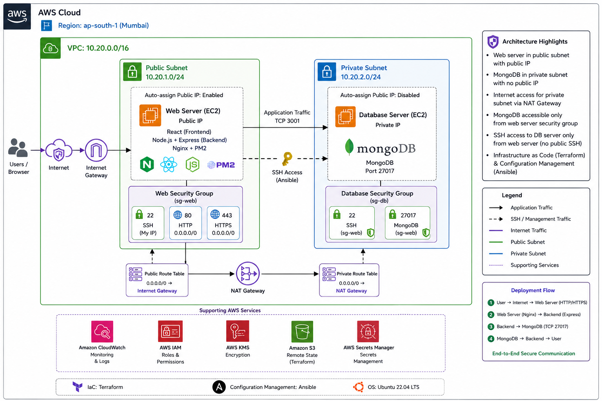
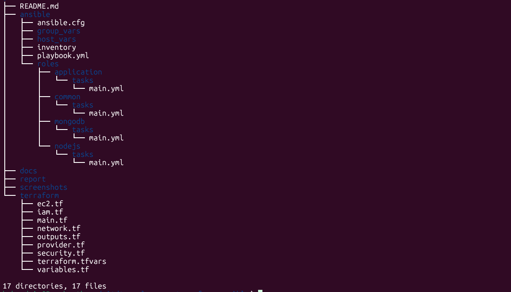

# 🚀 TravelMemory Deployment using Terraform & Ansible on AWS

<p align="center">


</p>

---

# 📖 Project Overview

This project demonstrates a complete Infrastructure as Code (IaC) and Configuration Management workflow using **Terraform** and **Ansible** to deploy the **TravelMemory** application on **Amazon Web Services (AWS)**.

The infrastructure is provisioned using Terraform, while Ansible automates the configuration of both the application server and the MongoDB database server.

The deployment provisions:

- Amazon VPC
- Public Subnet
- Private Subnet
- Internet Gateway
- NAT Gateway
- Route Tables
- Security Groups
- IAM Role & Instance Profile
- EC2 Web Server
- EC2 MongoDB Server
- Node.js 20
- MongoDB 8.0
- PM2 Process Manager
- TravelMemory Backend Application

The repository also includes detailed documentation for each deployment stage under the `docs/` directory, making it easier to understand and reproduce each phase of the implementation.

---


# 🎯 Objectives

- Provision AWS infrastructure using Terraform
- Configure servers using Ansible
- Deploy TravelMemory backend
- Configure MongoDB in a private subnet
- Manage the application using PM2
- Verify successful deployment

---

# 📑 Table of Contents

- [Project Overview](#-project-overview)
- [Architecture](#-architecture)
- [Repository Structure](#-repository-structure)
- [Project Documentation](#-project-documentation)
- [Terraform Deployment](#-terraform-deployment)
- [AWS Infrastructure](#-aws-infrastructure)
- [Ansible Configuration](#-ansible-configuration)
- [Application Verification](#-application-verification)
- [Challenges Faced](#-challenges-faced)
- [Future Enhancements](#-future-enhancements)
- [Author](#-author)

---

# 🏗 Architecture

```text
                          Internet
                              │
                     Internet Gateway
                              │
                    Public Route Table
                              │
                 Public Subnet (10.0.1.0/24)
                              │
               TravelMemory Web Server (Ubuntu)
                ├── Node.js 20
                ├── PM2
                └── TravelMemory Backend
                              │
                     Private Route Table
                              │
                 Private Subnet (10.0.2.0/24)
                              │
                  MongoDB Server (Ubuntu)
                         MongoDB 8.0
```

---

# 📂 Repository Structure

Repository Structure:



```text
travelmemory-terraform-ansible/
├── README.md
├── Ansile_README.md
├── Terraform_README.md
├── terraform/
│   ├── provider.tf
│   ├── variables.tf
│   ├── terraform.tfvars
│   ├── network.tf
│   ├── security.tf
│   ├── iam.tf
│   ├── ec2.tf
│   ├── outputs.tf
│   └── main.tf
│
├── ansible/
│   ├── inventory
│   ├── ansible.cfg
│   ├── playbook.yml
│   ├── group_vars/
│   └── roles/
│       ├── common/
│       ├── nodejs/
│       ├── mongodb/
│       └── application/
│
├── screenshots/

```
---
# 📚 Project Documentation

Detailed documentation for each component is available in the `docs` directory.

| Documentation | Description |
|---------------|-------------|
| [Terraform Deployment](Terraform_README.md) | Infrastructure provisioning using Terraform |
| [Ansible Deployment](Ansile_README.md) | Configuration management, roles, inventory, playbooks |


---

# ⚙️ Prerequisites

The following software was installed before deployment.

| Software | Version |
|----------|----------|
| Terraform | v1.14.x |
| Ansible | 2.16.x |
| AWS CLI | v2 |
| Ubuntu | 24.04 |
| Node.js | v20 |
| MongoDB | 8.0 |
| PM2 | Latest |
| Git | Latest |

---

# ☁ AWS Region

```
ap-south-1 (Mumbai)
```

---

# 📦 Application Repository

https://github.com/UnpredictablePrashant/TravelMemory

---

# 🏗 Infrastructure Repository

https://github.com/anilkumarrajana/Terraform_Assignment.git

---

---

